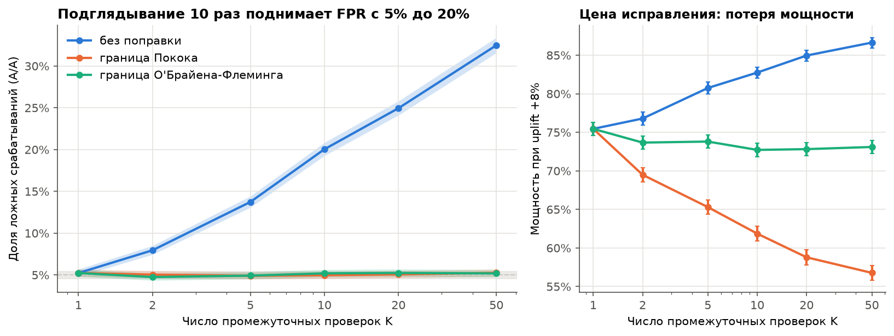
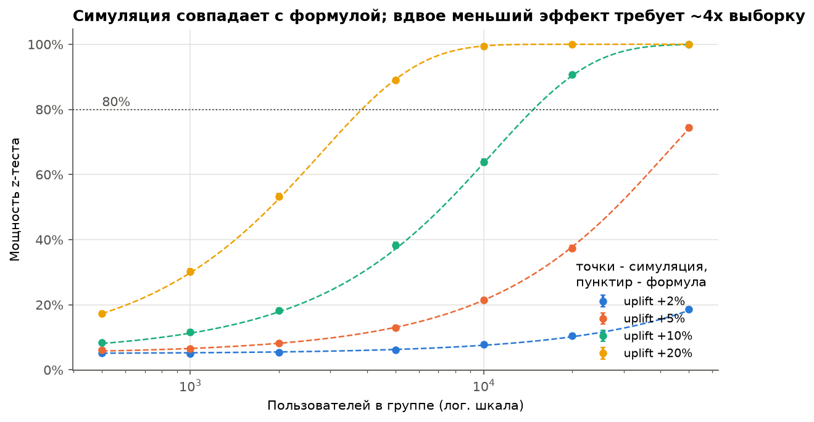
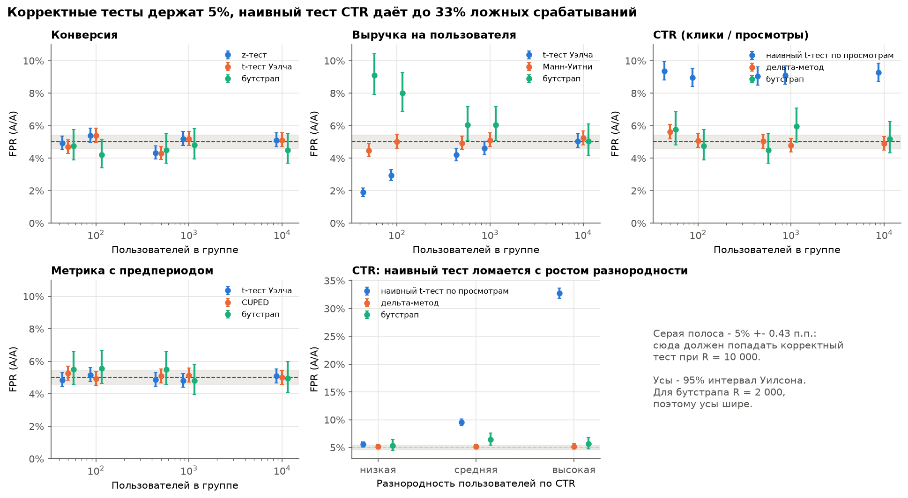
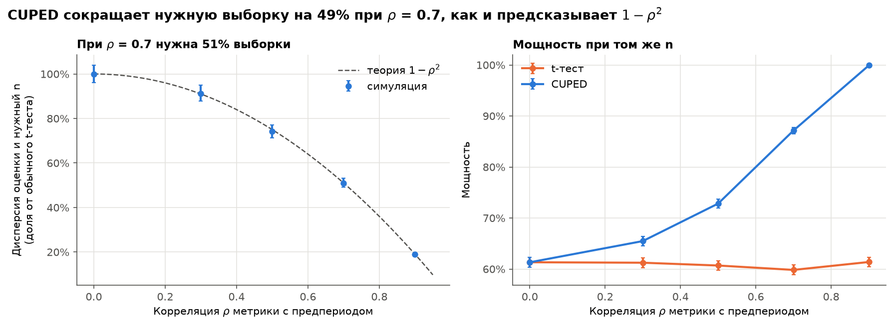

# Монте-Карло симулятор A/B-тестов

Монте-Карло проверка статистических методов A/B-тестирования: где тесты ошибаются и как это исправить.

Более 1,1 млн симулированных экспериментов с известным истинным эффектом, десяток критериев,
написанных на NumPy и сверенных со SciPy и statsmodels, SQL-разбор реального A/B-теста мобильной игры
и анализ результатов симуляций в DuckDB. Полный разбор - в [`notebooks/report.ipynb`](notebooks/report.ipynb).

## Главные выводы

- **Подглядывание 10 раз поднимает долю ложных срабатываний с 5% до 20%**, 50 раз - до 32%.
  Граница О'Брайена-Флеминга возвращает 5% и теряет всего 3 п.п. мощности, граница Покока - 14 п.п.
- **Наивный t-тест CTR по просмотрам даёт до 33% ложных срабатываний** (при сильно разнородных
  пользователях), а его 95% интервалы накрывают истину лишь в 67% случаев. Дельта-метод держит 5%.
- **CUPED при корреляции 0,7 с предпериодом сокращает нужную выборку на 49%**, ровно как $1 - \rho^2$.
- **10 метрик без поправок дают 40% шанс хотя бы одной ложной находки** (20 метрик - 64%).
  Холм держит 5% и мощнее Бонферрони, Беньямини-Хохберг держит долю ложных открытий, а не FWER.
- **Вдвое меньший эффект требует вчетверо большей выборки:** для +10% к конверсии 10% нужно
  около 14 750 пользователей на группу, и симуляция совпадает с формулой.
- **Если из группы B выпадает 4% малоактивных пользователей, A/A-тест "находит" рост в 41% случаев**,
  а проверка SRM по порогу 0,001 этого ещё не замечает.
- **Для выручки нет лучшего теста:** t-тест теряет мощность на тяжёлых хвостах (с 53% до 7%),
  логарифм и Манн-Уитни почти не видят рост чека при 90% нулей, а отсечение выбросов
  помогает только на очень тяжёлых хвостах и проверяет уже не среднюю выручку.

## Графики


Каждая промежуточная проверка - ещё один шанс случайно увидеть $p < 0.05$. Последовательные границы
возвращают 5%, а О'Брайен-Флеминг почти не теряет мощность: он строгий в начале и мягкий в конце.


Точки - симуляция (10 000 экспериментов в каждой), пунктир - формула размера выборки.
Теория попадает в 95% интервал симуляции в 96% точек.


На малых выборках выручки t-тест консервативен, а бутстрап либерален. Ошибка наивного теста
CTR не уходит с ростом n, потому что неверна сама модель дисперсии.


Снижение дисперсии совпадает с теорией $1 - \rho^2$ во всех точках, а FPR с CUPED остаётся 5%.

## Реальный тест: Cookie Cats

90 189 игроков, ворота (вынужденная пауза) на 30-м уровне против 40-го. Перенос на 40-й уровень
снижает удержание на 7-й день на 0,82 п.п. (с 19,0% до 18,2%, 95% интервал от -1,3 до -0,3 п.п.,
$p = 0.002$; z-тест и бутстрап совпадают), значимого выигрыша по другим метрикам нет.
**Рекомендация - оставить ворота на 30-м уровне.** Разбор сделан SQL-запросами в DuckDB
([`sql/cookie_cats`](sql/cookie_cats)): SRM, доверительные интервалы, перцентили, децили через
`NTILE` и накопленный retention через оконные функции.

## Чеклист перед запуском A/B-теста

1. Рассчитать размер выборки заранее по MDE и не останавливать тест раньше.
2. Не подглядывать. Если промежуточные проверки нужны, заложить границу О'Брайена-Флеминга.
3. Проверять SRM (хи-квадрат, порог 0,001) до анализа метрик: перекос значит, что группы несопоставимы.
4. Для метрик-отношений (CTR, средний чек) брать дельта-метод или бутстрап по пользователям,
   а не тест по событиям.
5. Если есть данные до теста, использовать CUPED: та же мощность на меньшей выборке.
6. Если метрик много, заранее выбрать основную, а к остальным применять поправку Холма.
7. Для выручки заранее решить, что проверяем: среднее (t-тест, бутстрап, нужно много данных)
   или "типичного" пользователя (логарифм, отсечение - это уже другая гипотеза).

## Производительность

Задача - A/A-тесты t-тестом Уэлча на выручке. AMD Ryzen 7 5700U, WSL2.

| Способ | n = 1 000, R = 100 000 | n = 10 000, R = 10 000 |
| --- | --- | --- |
| Цикл Python по повторениям | 21,7 с | 7,1 с |
| Векторизация NumPy (матрица reps x n) | 12,1 с (1,8x) | 12,6 с (0,6x) |
| Векторизация + 4 процесса | 5,0 с (**4,4x**) | 3,5 с (2,1x) |

Векторизация выигрывает, когда велики накладные расходы на каждый эксперимент. При большом n
почти всё время уходит на генерацию случайных чисел, и векторизация не помогает: массив одного
эксперимента (80 КБ) помещается в кэш процессора, а матрица - нет. Там ускоряют только процессы.
Для конверсии есть отдельный приём - генерировать сразу биномиальные суммы вместо n наблюдений.

Что сделано для скорости и воспроизводимости:

- **Чанки по повторениям** с ограничением памяти: в одном массиве не больше 1 млн чисел (около 8 МБ),
  а процессов не больше, чем гигабайт свободной памяти.
- **Параллелизация по сетке параметров** через joblib: каждый чанк каждой точки - отдельная задача.
- **Независимые случайные потоки:** у каждой точки сетки свой `SeedSequence` (из seed и ключа точки),
  у каждого чанка - дочерний поток через `spawn`. Результат одинаковый при 1 и 4 процессах (есть тест).
  Один seed во всех процессах - частая ошибка: "разные" эксперименты просто повторяют друг друга.

## Как запустить

Нужны [uv](https://docs.astral.sh/uv/) и make.

```bash
make install   # зависимости (Python 3.12)
make data      # скачать датасет Cookie Cats в data/
make sim       # симуляции в results/*.parquet (около 25 минут в 4 процесса)
make report    # графики и выполнение notebooks/report.ipynb
make test      # pytest
```

Один сценарий: `uv run python -m abtest_sim.cli sim -s peeking`. Бенчмарк: `make benchmark`.
Все параметры лежат в [`config.yaml`](config.yaml).

## Структура

```text
config.yaml                 параметры всех сценариев
src/abtest_sim/
  generators.py             генераторы метрик с известным эффектом
  stat_tests.py             критерии на NumPy: z, Уэлч, Манн-Уитни, бутстрап, дельта-метод, CUPED, хи-квадрат
  corrections.py            Бонферрони, Холм, Беньямини-Хохберг; границы Покока и О'Брайена-Флеминга
  power.py                  формулы мощности и размера выборки
  runner.py                 цикл Монте-Карло, параллелизация, запись в Parquet
  scenarios/                сценарии 1-8
  plots.py                  графики (данные берутся SQL-запросами)
  cookie_cats.py, data.py   реальный датасет
sql/cookie_cats/            разбор реального теста
sql/simulations/            FPR, мощность, FWER и FDR, покрытие интервалов по результатам симуляций
notebooks/report.ipynb      итоговый отчёт
tests/                      сверка с SciPy и statsmodels, контрольные точки, воспроизводимость
```

## Как проверялась корректность симулятора

- Каждый критерий совпадает с SciPy или statsmodels на фиксированных данных (до 1e-8),
  дельта-метод - с бутстрапом по пользователям.
- Контрольные точки: FPR около 5% в A/A-тестах, $n \approx 14\,700$ для +10% к конверсии 10%,
  FWER около 40% для 10 метрик, снижение дисперсии CUPED по формуле $1 - \rho^2$,
  границы Покока совпадают с таблицами.
- Каждая доля из симуляции приводится с 95% интервалом Уилсона.

## Данные

Kaggle: [Mobile Games A/B Testing - Cookie Cats](https://www.kaggle.com/datasets/yufengsui/mobile-games-ab-testing).
Сырые данные в репозиторий не входят: `make data` скачивает их через Kaggle API (если есть токен)
или из публичного зеркала на GitHub.
